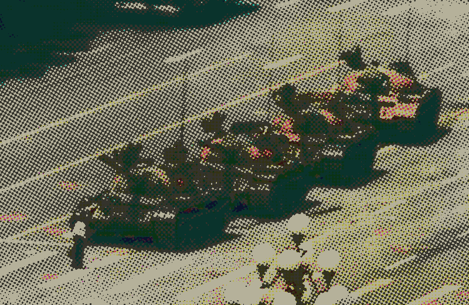
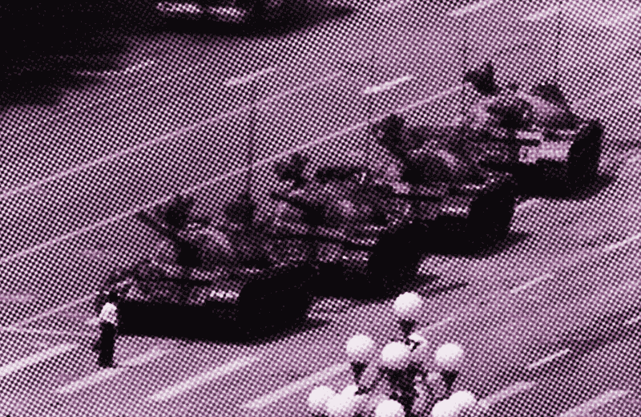
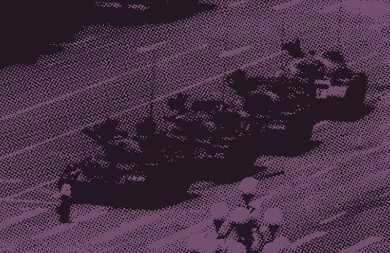
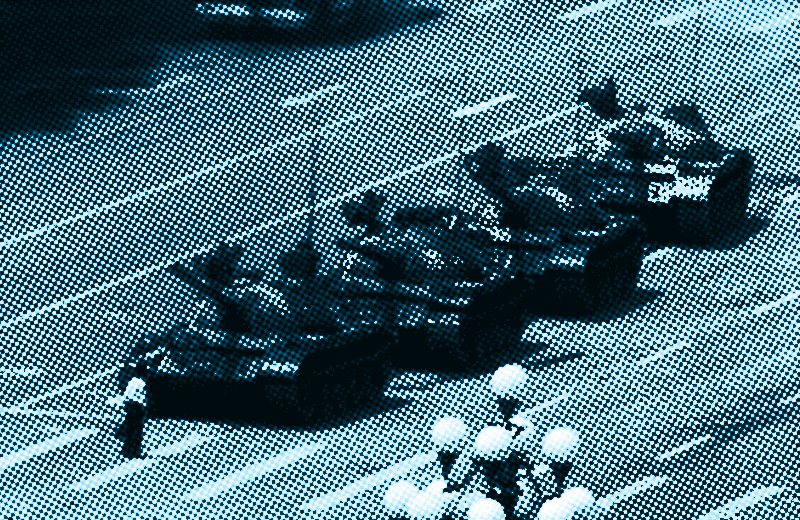

# am-halftone

Simulate a printed **AM halftone dot grid** on a digital image with ImageMagick:
split into CMYK channels, overlay a rotated checkerboard threshold tile on each
channel at print screen angles, recombine — so tone is carried by dot *size*,
like ink on paper.

```bash
bin/halftone.sh --in photo.jpg --out photo-halftone.png --mode truecmyk
bin/halftone.sh --in photo.jpg --out photo-pink.png     --mode pink-palette
bin/halftone.sh --batch ./shoot   # originals -> big/, outputs -> smol/
bin/check.py                      # executable gate
```

| Mode | Result |
|---|---|
| `truecmyk` (default) | Four rotated CMYK grids, binary channels — the most print-accurate |
| `pink-old` | Black + one pink (`#A2719B`), big dots — the blog's original look |
| `pink-palette` | Remapped to a white→black→pink→darker-pink gradient, 32 colors |
| `light-fix` | No grid; the author's fallback for overwhelmingly light images |
| `rgb` | Same pipeline in RGB (3 channels) — less print-accurate, more intense |

Options: `--width` (default 800), `--scale` (dot size, default 2),
`--contrast` (sigmoidal pre-boost, default 0, 4–6 is punchy),
`--palette`, `--colors` (default 32), `--pink` (default `#A2719B`).
Needs ImageMagick 6 (`convert`) or 7 (`magick`).

## Examples

"Tank Man", Tiananmen Square, Beijing, 5 June 1989 — photo by Jeff Widener (AP).
Transforms shown; the original photograph is AP-copyrighted and used here as
a demo only. All renders at `--scale 2 --contrast 5`.

| `truecmyk` — four rotated CMYK grids | `pink-palette` — white→pink→darker-pink→black |
|---|---|
|  |  |

| `pink-old` — binary black + `#A2719B` | cyan (`pink-palette --pink '#00AEEF'`) |
|---|---|
|  |  |

## Attribution

The method is by the author of **dead.garden**, from the blog post
["How my images are dithered"](https://dead.garden/blog/how-my-images-are-dithered.html)
(posted from Erfurt, DE). They are upfront about provenance: they found the
core ImageMagick recipe online (the original link is lost), adapted it, and
"can't claim to be the expert on what each individual argument does."

What is theirs: the CMYK channel-split plus rotated 2×2 checkerboard
threshold-tile pipeline at print screen angles (0/15/45/75, after DIN 16547's
answer to moiré); the `-colors 2` per-channel "true CMYK" fix so dots vary in
size rather than darkness; the pink monochrome variants (`+level-colors
black,#A2719B`, palette `-remap`); the `-modulate 300,200,100 -negate` fallback
for very light images; and the `big/`/`smol/` batch script.

What is mine (packaging only): the parameterized `bin/halftone.sh`, the
auto-generated default palette (built from the post's documented stops), the
`rgb` mode extension, the `bin/check.py` executable gate, and the annotated
write-up in `references/method.md` and `SKILL.md`.

Their caveats, preserved verbatim in spirit:

- "If you care about the method this is **not dithering**. Or at least it's
  the most unnecessarily computationally expensive form of dithering I've come
  across."
- ~10 seconds per big image on an 11-year-old laptop.
- Not a file-size strategy: overlaying four grids *creates* new colors and the
  pattern fights compression.

And their request, honored here: the test images used during development are
generated by ImageMagick itself — "please don't feed images of me and my
friends to an LLM."

## Layout

- `SKILL.md` — the agent skill (purpose, pipeline, modes, operating rules)
- `bin/halftone.sh` — the recipe as a script
- `bin/check.py` — executable gate: runs all grid modes on a generated test
  image and asserts the promised color counts
- `references/method.md` — full annotated walkthrough, screen-angle
  background, and the author's original batch script
